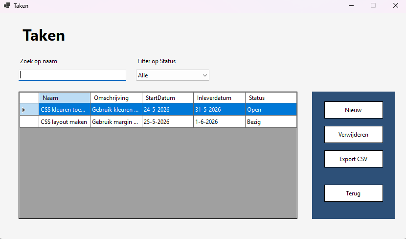
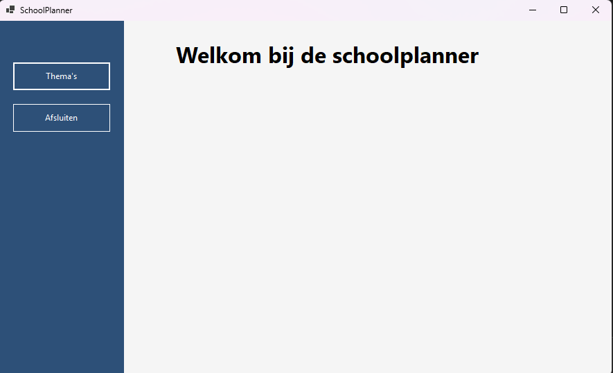
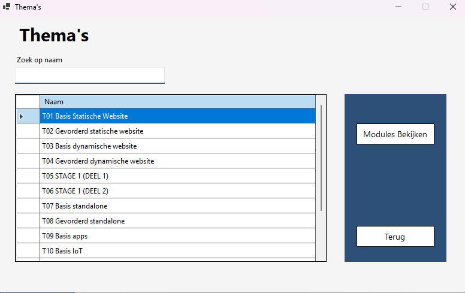
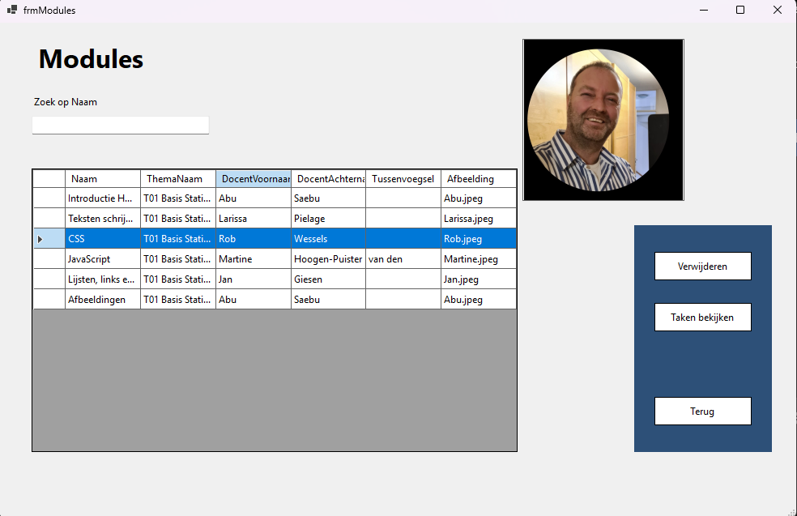
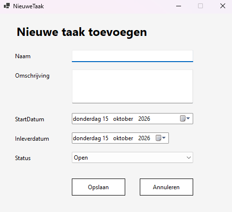

# SchoolPlanner

SchoolPlanner is een schoolproject dat ik heb gemaakt tijdens mijn opleiding Software Development.

De applicatie is gebouwd in C# met Windows Forms en is bedoeld voor het beheren van schooltaken, modules en thema's.

## Functionaliteiten

- Taken beheren
- Modules beheren
- Thema's beheren
- Overzicht van schoolplanning

## Gebouwd met

- C#
- Windows Forms
- Visual Studio

## Doel van het project

Met dit project heb ik geoefend met C#, Windows Forms en het structureren van een applicatie met verschillende modellen, views en controllers.

## Screenshots

### Takenoverzicht

### Overige schermen

  
  

  
  

